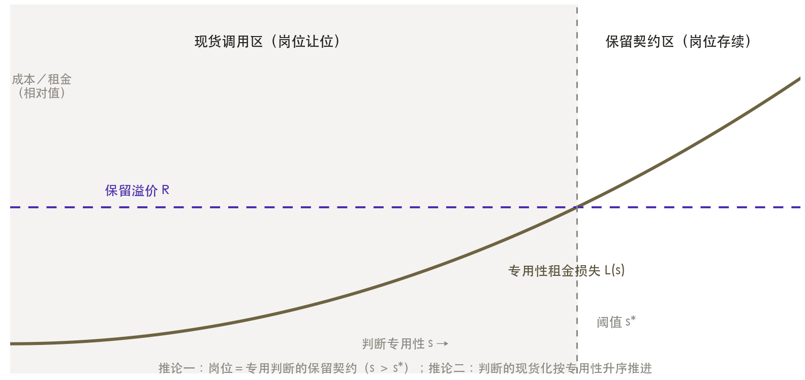
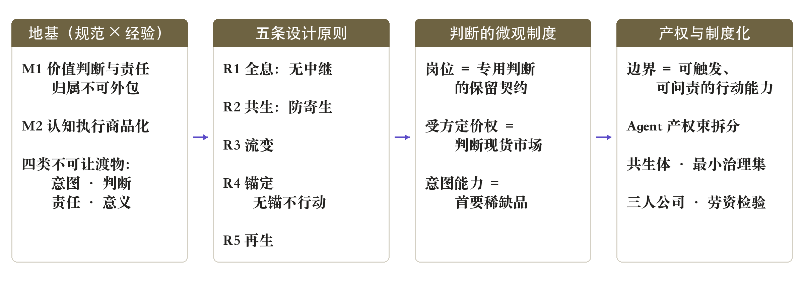
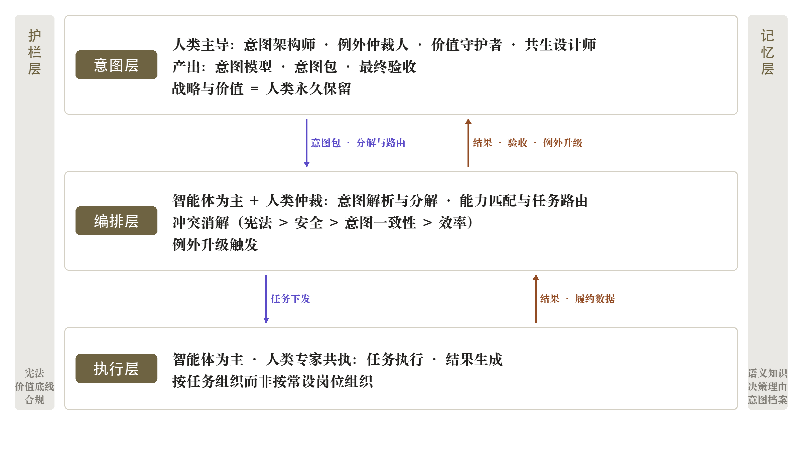
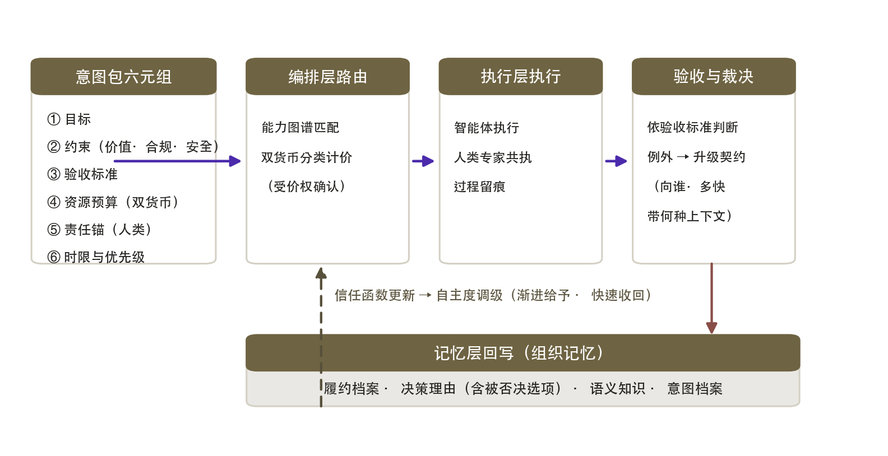
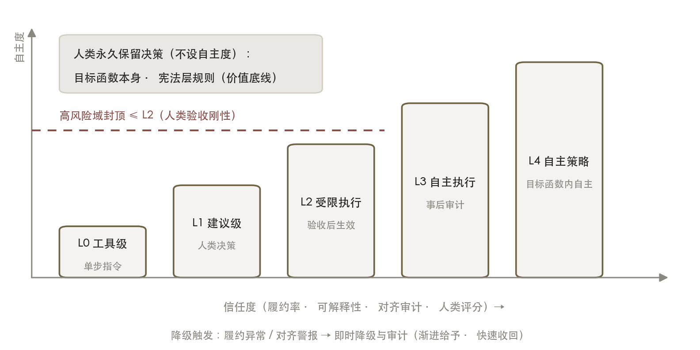
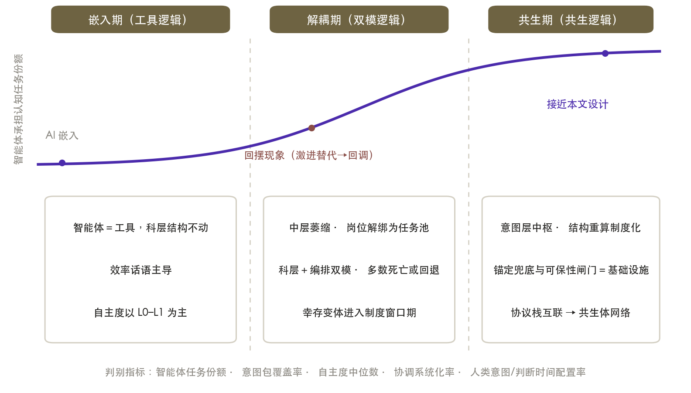

# When Execution Becomes Boundless: Organizational Form in the Age of Artificial Intelligence

*Wang Zexin · v1.0 · October 2026 · CC BY-NC-ND 4.0*

> Full English text. The Chinese original is in `../zh/`. Section numbering follows the original.

## I. Introduction: When Execution Becomes Boundless

Every major turn in organization theory began when a factor of production became purchasable.

The Industrial Revolution turned physical effort into a commodity. Employers no longer had to negotiate with land and guild; they bought muscle and attention by the day in a labor market. The factory followed — the first organization in human history designed around purchasable physical effort. The information revolution turned information processing into a commodity. Filing systems, the telephone, managerial accounting, and the computer converted the collection, storage, and transmission of information into metered services. The functional hierarchy and the multidivisional form followed, recasting the organization as an information-processing machine [1,2]. Artificial intelligence is now turning a third factor into a commodity: cognitive execution — comprehension, retrieval, reasoning, generation, multi-step task execution, and coordination among agents — is becoming a service that can be called per invocation and priced by the call [3,4,5].

Each commoditization poses the same theoretical question: why does the organization still need the thing around which it was previously built? After physical effort was commoditized, humans remained at the center of the organization, because machines did not decide what to produce. After information processing was commoditized, humans remained at the center, because machines did not understand why information was wanted. Now that cognitive execution is following the same path, the question arrives in its sharpest form: when execution becomes boundless, why does the organization still need people?

This is not the employment question of whether AI will replace human workers. It is a question about the ontology of organization theory: is an organization still a combination of persons, and if not, what is it?

What this paper calls principles are rules we choose to observe, not conclusions derived from axioms. What it calls propositions are, for the most part, untested; several of them cannot be tested with the data currently available. Wherever the text says *must*, it may be read as *must given the premises this paper adopts*.

Industry has moved first. Microsoft's 2025 Work Trend Index proposes the "frontier firm," arguing that the basic unit of management will shift from span of control to the ratio of humans to agents [6]. Gartner projects that by 2028 at least 15 percent of routine work decisions will be made autonomously by agents, and that 33 percent of enterprise software will embed agent capabilities [7]. Customer service, software development, and human resources have each seen agents displace human teams at scale; Klarna's reversal — rebuilding its human seats a year after an aggressive deployment — indicates that substitution alone runs into a hard boundary.

Scholarship has lagged, and it is fragmented. Research on algorithmic management examines algorithmic control over individual workers [8,9]. Work on human–AI collaboration examines the paradox of automation and augmentation [10,11,12]. AI economics models substitution and complementarity through the task framework [13,5,14]. Organization and knowledge-structure research has long offered an information-theoretic account of hierarchy [15] and a communication-cost theory of delegation [16]. Chinese scholarship has begun systematic discussion as well [17,18]. Each line runs on its own. What is missing is a framework that treats organizational boundary, membership, coordination, decision rights, and the structure of accountability as a single design problem. This paper attempts to supply one.

The stance taken here is that the organization is not only a product of evolution but an object of design [19,20], and that design requires theory as its foundation. The strategy is to treat three levels of the question as one joint problem. At the micro level: what becomes of employment and of the post when judgment can be bought by the call? At the normative level: which end of the chain of delegation can a machine not occupy? At the macro level: how does the property arrangement of the agent — the carrier of both execution and judgment — determine the fork in organizational form? The answers converge on one organizational design, the symbiotic organization, and on its limiting case, the three-person firm; both are then converted into testable propositions.

The paper proceeds as follows. Section II examines why existing organizational forms fail under the execution-allocation paradigm. Section III sets out the microeconomics of judgment: the dissolution of the post, the spot-marketization of judgment, and the new scarcity of intent capacity. Section IV establishes the normative foundation — the theory of inalienability and five design principles. Section V takes up the macro problem of property: who owns the agent, and how the boundary of the organization is redrawn. Section VI presents the institutional design: the symbiotic organization, its minimal governance set, and the labor test. Section VII traces evolutionary paths and the limiting case. Section VIII collects the propositions. Section IX discusses tensions, the dark side, and failure conditions. Section X concludes.

## II. Theoretical Reflection: The Failure of the Execution-Allocation Paradigm

Existing organizational forms — bureaucracy, flattening, platform ecosystems, and the "frontier firm" discourse alike — share one unstated paradigm: the organization is a device for allocating human execution capacity. The post packages that capacity; the hierarchy aggregates it; incentives price it; the employment contract procures it. AI has not struck every part of this paradigm evenly. It has removed a specific part of its foundation.

The case for bureaucracy reduces to three functions: information relay, behavioral supervision, and dependency coordination [21,22,23]. Agents are taking over full-sample, real-time processing of semantic information, and the information spine that aggregated upward level by level is being hollowed out. The digitization of work traces turns supervision from spot checks into replayable audit. Task dependencies can be modeled explicitly, so coordination no longer has to rest on the people at hierarchical nodes.

A qualification is due at once. The information spine is only one of bureaucracy's supports. Its roots also lie in authority boundaries, ownership and control, decision responsibility, resource allocation, conflict resolution, incentives, identity, and legitimacy — and AI bears on these in inconsistent directions. The claim made here is therefore narrow: the structural part of bureaucracy built on information compression, relay, and manual scheduling is losing marginal economic value. Its authority and accountability functions have not disappeared. They have changed footing, as Sections IV and VI argue.

Flattening and self-management run into an arithmetic fact. Compressing levels does not eliminate coordination work; it returns the load to the cognitive bandwidth of senior managers and to the lateral communication time of members. Human attention bandwidth has not expanded with AI [24,25]. Platforms and ecosystems dissolve boundaries, but the platform core remains a bureaucracy built around human posts; and once agents can move across boundaries, the employer–employee contract can no longer define membership [26,27]. The "frontier firm" discourse catches that the ratio of humans to agents will displace span of control [6], but it answers none of the institutional detail: membership, decision rights, the anchoring of accountability, structural recomposition.

Taken together, the diagnosis yields six design requirements.

**DR1 Computable coordination.** Coordination is borne by systems; humans retreat to rule design and exception adjudication.

**DR2 Dual membership.** Non-human actors receive a symmetric institution covering the full lifecycle.

**DR3 Structural fluidity.** Structure is recomputed against task, capability, and trust.

**DR4 Graded decision rights.** Decision rights are allocated by risk and reliability, not by rank.

**DR5 Anchored accountability.** Every autonomous chain of action terminates in an identifiable human subject.

**DR6 Regeneration of meaning.** Judgment and the sense of meaning are treated as scarce resources that require active maintenance.

These six requirements find their place in the normative foundation of Section IV and the institutional design of Section VI.

## III. The Microeconomics of Judgment: From Posts to Calls

### 1. Three conversions of the organizational object

Moving the central variable of organization theory from execution capacity to judgment rights requires first stating how the two differ in kind. Execution capacity is strongly homogenizing, highly verifiable, storable (it settles into software), and normatively light. Judgment is the opposite on every count: it is rivalrous (a person's attention can go to one decision at a time), context-dependent (removed from the intent that frames it, the quality of judgment falls sharply), non-storable (judgment capacity must be maintained in use, and atrophies when idle), and normatively heavy (to judge is to assign value to an outcome, and who assigns it, and to what, is a question of value rather than of technique). An organization built around a factor must design its institutions according to that factor's economic properties. To allocate execution capacity, the optimal institutions are the post, the hierarchy, and supervision. To allocate judgment rights, they are pricing, invocation, and anchoring.

The shift has a direct lineage. Garicano [15] explains hierarchy as a mechanism for matching problems to those who hold the knowledge to solve them, with span determined by the cost of acquiring knowledge. AI drives the cost of matching routine problems to near zero, so the residual function of hierarchy converges on exception handling — which is the strict version of what Section VI calls the four tasks of the manager. Dessein [16] shows that when communication costs are low relative to control loss, the principal should delegate rather than control directly. Agents collapse control loss, which makes the cost of stating intent — translating a vague wish into a clear, executable, verifiable statement of objectives — the decisive variable. Sections III and VI institutionalize these two insights as intent engineering and the intent package.

### 2. The dissolution of the post and the spot-marketization of judgment

The employment contract is a bundled contract. The firm buys, in advance, the availability of a person's time, skill, and execution capacity, pays the dual cost of supervision and idleness, and uses the post as the physical unit of the bundle. The economic reason for the post was never the headcount. Execution capacity was hard to meter and deliver by the call, so it had to be bought in lots [28].

This is Simon's classic account of the employment contract: what is purchased is not a specific behavior but a zone of acceptance, and authority is the right to choose within that zone [54]. What needs adding is that when every behavior inside the zone can be invoked and priced separately, the zone that had to be bought in lots collapses. The metering problem remains. What changes is the zone itself: it ceases to exist. The further claim is that judgment — the least commoditizable residue of the employment relation — is acquiring the technical conditions for delivery by the call. "Give me one market study, one exception ruling, one strategic assessment" becomes a procurement action isomorphic to invoking a retrieval. A firm can then buy a judgment without buying a person's full capacity.

The underlying reason for buying in lots is metering cost: where individual contribution cannot be separated cheaply, one buys the team [55]. The observation here is that agents make metering nearly free — every call has a log, a price, and an owner. The immediate cause of the bundle's dissolution is therefore not that execution became cheap, but that it became meterable.

Judgment is procured under two contractual forms: the retainer, the residual form of the traditional post, which buys continued availability, contextual familiarity, and a response commitment at a unit price above the spot rate; and the spot call, bought by the call, priced by the receiving party, dissolved on delivery. The boundary between them can be captured by a minimal model. Let the specificity of a class of judgment be *s* — the contextual investment the judge has made in this organization's intent model, which makes that judge's delivery to this organization better than that of an unfamiliar supplier. Let *L(s)* be the specificity rent lost through spot-marketization, increasing in *s*. Let *R* be the retainer premium, the amount by which the retainer unit price exceeds the spot price, buying availability and contextual investment. Spot calls are then feasible if and only if

**L(s) < R**

that is, if the specificity rent lost is smaller than the retainer premium. Two corollaries follow.

*Corollary 1 (post persistence).* The post does not disappear. It is the retainer contract for specific judgment, and it survives where *s* exceeds the threshold — the level at which the specificity rent lost exactly equals the retainer premium. These are domains where judgment depends deeply on the organization's intent context: strategy, high-stakes adjudication, the guardianship of organizational memory. Below the threshold, the post is displaced by spot calls.

*Corollary 2 (ordering).* Spot-marketization proceeds in ascending order of specificity: research retrieval, data analysis, and first drafts first; personnel rulings, crisis decisions, and value trade-offs last. The ratio of retainer humans to spot-call humans within an organization can therefore serve as a measurable index of organizational intelligence.

The model also demands an institutional symmetry. If judgment can be bought by the call, then suppliers of judgment — human or agent — should enter the same quality-governance structure. Section VI extends the trust function, the performance record, and the autonomy level (for humans, invocation priority and pricing tier) to human judges. The symbiotic organization thereby becomes a two-sided market for judgment, with humans and agents institutionally symmetric. What remains asymmetric is the inalienability argued in Section IV. The boundary between retainer and spot call is shown in Figure 1.

### 3. Intent capacity becomes the primary scarce good

The Hayekian [29] knowledge problem was that dispersed information needs aggregating. The problem of the AI era is its mirror image: concentrated intent needs stating. When execution is nearly free, the ceiling on organizational output no longer depends on how many people execute, but on whether the principal can say clearly what is wanted. Building an application once required a full chain of product manager and front- and back-end engineers; now it requires one person who can state the requirement. A new bottleneck appears: intent capacity — the ability to translate a valued wish into a clear, executable, verifiable intent package.

Three organizational consequences follow.

First, the primary stratification of the organization is no longer by skill but by intent capacity. The intent architect becomes a key occupation, and its quality is measurable — for instance, by double-blind retelling deviation, the gap between a second reader's restatement of the package's objectives and the original meaning.

Second, the cost of stating intent becomes the real constraint on organizational expansion. This is the theorized form of the intuition that the boss may simply not be able to say what he wants.

Third, an open gap remains. When the intent pool holds several principals — five partners, five departments — "what the organization wants" becomes an aggregation problem, and the difficulties of social choice theory return through the back door. The design of the intent layer in Section VI assumes aggregation is already complete. The mechanism design of multi-principal intent aggregation is an explicit task for later work.

## IV. Inalienability: Where the Chain of Delegation Ends

### 1. The meta-axiom and the empirical premise

Boundless execution does not make the organization disappear. It forces the organization back to an older question: how far can a chain of delegation be extended, and who must stand at its end? An organization is delegation layered upon delegation. Shareholders delegate to a board, the board to management, management to employees; management now delegates execution again, to agents. Delegation can be extended level by level, but every level requires the delegate to carry out the principal's intent and answer for the result. For the chain to hold at all, it must terminate in a subject that is no longer re-delegated. Hence the normative foundation of this paper:

**Meta-axiom (M1).** Any organization with sustained capacity to act must contain a mechanism of value judgment and allocation of responsibility that cannot be outsourced indefinitely.

M1 is not derived from any empirical fact. It is the constitutive commitment of the organization as a social institution: an action system that can find neither a final judge nor a final bearer of responsibility is not an organization but an uncontrolled chain reaction. M1 is a normative commitment. The empirical premise that carries it forward is:

**Empirical premise (M2).** Cognitive execution capacity is being commoditized: comprehension, retrieval, reasoning, generation, and multi-step execution are becoming services that can be called per invocation and priced by the call.

M1 answers what must remain. M2 answers what is leaving. Their intersection is the entire problem space of organizational design in the age of AI: hand the departing execution to markets and machines; keep the judgment and responsibility that cannot depart institutionally in human hands. Five design principles follow. First it must be said what "remains."

### 2. Four inalienable things

**Intent: ownership of purpose.** Delegation begins with intent — what is wanted, why, and within what bounds. Intent cannot be alienated, not because a machine cannot generate statements of goals (it plainly can), but because generating intent presupposes owning a purpose. A system in which the machine sets the purpose has already inverted the delegation relation; the human is no longer the principal. The inalienability of intent is constitutive: to alienate intent is to alienate the status of principal itself.

**Judgment: the valuer that accountability requires.** Judgment as a central construct of organization theory traces to Knight's distinction between risk and uncertainty: risk can be probabilized, uncertainty cannot; bearing consequences that cannot be probabilized is the substance of entrepreneurial judgment and the ground of the residual claim [56]. This paper keeps the distinction but extends its scope from ownership to every link of the delegation chain. Raisch and Krakowski [10] distinguish automation from augmentation; the deeper reason is that the value assigned to an outcome — that this result is better than that one, that this loss is more acceptable than that gain — cannot be derived from a factual description. A machine can predict. Whether something is worth it requires a subject that bears the consequence. The inalienability of judgment is normative: accountability requires a valuer, and the valuer's standing comes from an interest in the consequence.

**Responsibility: legal personality and traceability.** Holding an agent to account is not feasible under current law. It holds no independent property and has no legal personality; the emergence of its decision chain cannot be attributed to intent or to negligence — a problem of measurement and enforcement cost in Barzel's sense [30]. Responsibility must therefore be anchored in a subject that holds property and legal personality. This is a requirement of traceability arising from the organization as a social institution; it is not a technical limitation. The inalienability of responsibility is legal-institutional: it can be redistributed by institutions — by the anchoring of Section IV.3 and the layered responsibility of Section VI — but it cannot be abolished.

**Meaning: the supply condition of judgment capacity.** Judgment capacity is not a stock asset but a capacity maintained in use. Outsource judgment to systems long enough, and humans lose the ability to adjudicate when the exception arrives [31,32]. The motive to maintain it comes precisely from members feeling that their judgment is wanted, believed, and empowered — that is, from meaning. The inalienability of meaning is therefore functional: it is the production condition of judgment capital. An organization that drains meaning will discover, at the next exception, that it cannot hire judgment.

The four rest on different kinds of reason: intent is constitutive, judgment is normative, responsibility is institutional, meaning is empirical. The difference deserves attention, because it determines the strength of the proposition that follows.

Of the four, only intent is negative in form. To alienate intent is to cancel the status of principal, and no empirical fact bears on it. The other three are conditional. The inalienability of judgment depends on the normative position that accountability requires a valuer with an interest in the consequence. The inalienability of responsibility depends on the institutional fact that current law does not recognize the personality of an agent. The inalienability of meaning depends on the empirical hypothesis that judgment atrophies when idle.

What this paper advances is therefore a conditional proposition.

**Proposition 0 (conditional inalienability).** The organization is a chain of delegation. Its execution can be extended indefinitely; whether the end must be bound to an inalienable subject depends on whether four conditions hold together: purpose must have an owner; accountability must have a valuer; liability must have a legal person; judgment capacity must have a maintenance mechanism. Under current institutions all four hold, so the chain terminates in a human. If any one of them fails through institutional change — legislation recognizing agent personality, for instance — the position of the end moves with it.

The strength of a conjunction equals its weakest link. Among the four, meaning is an empirical proposition (Proposition P6 in Section VIII), so Proposition 0 as a whole is a falsifiable hypothesis.

### 3. From the meta-axiom to design principles

From M1, M2, and the four inalienable things, this paper derives five design principles.

Each depends on one further substantive premise: visibility, the atrophy of judgment, the location of stability in the rule layer, named anchoring at the chain or function level, and the budgetability of scarce resources. These premises cannot themselves be derived; they can only be defended. The table below states the premise each principle rests on, and what fails if the premise fails.

| Principle | Substantive premise | What fails if the premise fails |
|---|---|---|
| R1 Holographic (visibility without relay) | Judgment presupposes visibility of the execution state | R1 alone |
| R2 Symbiosis (reciprocity against parasitism) | Judgment atrophies when idle | R2 and R5 together |
| R3 Fluidity (structure recomputed per task) | Stability belongs in rules, not in charts | Not the normative part; only the structural advice |
| R4 Anchoring (no action without an anchor) | Anchoring must be named at the chain level, not the function level | R4 degrades to function-level anchoring |
| R5 Regeneration (a budget for judgment) | Scarce resources must be budgetable and monitorable | The device only; the principle survives |

Among the five, R4 rests on the weakest premise. M1 requires only that a mechanism of inalienability *exist*; R4 requires a *named* subject at the end. Moving from existence to naming is a long step, and this paper offers one reason for taking it: authorization that cannot be named cannot be pursued. Whether that reason holds depends on whether legal and insurance institutions recognize such pursuit. Section VI treats its two institutional forms; Section IX treats its failure modes.

**R1, holographic visibility (visibility without relay).** Premise: the value judgment anchored by M1 presupposes visibility of the execution state; execution that cannot be seen cannot be judged. By M2, the cost of processing state information tends to zero, so a hierarchy whose relay function is to compress information level by level loses its reason to exist. Each actor should be able to obtain a computable view of context commensurate with its authority. A view without relay, but not without boundary, is the only accountable view.

**R2, symbiosis (reciprocity against parasitism).** Premise: judgment capacity — the carrier of M1 — atrophies when idle. The mutual dependence of humans and agents must therefore be designed as reciprocity, with net extraction by either side measured and corrected. A parasitic configuration, in which human judgment capacity is drained, is a failure path of M1; it has nothing to do with moral defect.

**R3, fluidity (structure recomputed per task).** By M2, capacity is present by the call, as a service. The static chart of post and department loses its necessity. The stability of structure should live in the rule layer rather than in a standing chart.

**R4, anchoring (no action without an anchor).** Every autonomous chain of action must terminate in an identifiable human subject; every autonomous exercise by an agent must fall within the authorization of a named subject. That subject may be an individual at the chain level or a post at the function level. The latter requires that the post already rest on a legal or contractual basis of responsibility, and that its scope cover the business function to which the chain belongs. Anchoring has a double function: a judicial one (pursuit) and a constitutional one (binding indefinitely expanding execution to finite human value judgment). The second is more fundamental than the first.

**R5, regeneration (a budget for judgment).** By the premise of R2, judgment capacity and the sense of meaning are scarce organizational resources. They require a budget, monitoring of stock, and a mechanism for replenishment.

The correspondence between the five principles and the six design requirements is: R1 to DR1 and DR3; R2 to DR6; R4 to DR5; R5 to DR6; R3 and M2 to DR2 and DR4. The normative part of the design is now complete. The two sections that follow handle the empirical part — how judgment is procured (already set out in Section III) and who owns the carrier of execution capacity (Section V) — before the institutional design can be addressed. The logic connecting the meta-axiom, the empirical premise, the four inalienable things, the design principles, and the institutional devices is shown in Figure 2.

### 4. What this paper does not claim

First, it does not claim that machines cannot judge. They can, and they will judge better. The claim is that the consequence of judgment must have a bearer.

Second, it does not claim that human judgment is superior. Human judgment is often worse. The question here is not superiority but attribution.

Third, it does not claim that the design has been validated. It is a design, not a discovery. The test program is set out in Section VIII, and readings from two controlled runs appear in Section IX.3. What they yield is a boundary, not a validation.

Fourth, it does not claim applicability to every organization. The aggregation of intent across multiple principals is not solved here (see Section IX), so the present form holds only for a single principal.

Fifth, it does not claim necessity. It claims what ought to be, and specifies the devices that would make it so.

## V. Property in Action Capacity: Who Owns the Agent

### 1. Redefining the boundary: from headcount to action capacity

Coase's [33] boundary question was which transactions are carried out inside the firm. In the age of the employment contract, the answer was summarized by headcount: the boundary of the organization was the boundary of the payroll. Once execution and judgment can both be called by the invocation, that summary fails. A firm with no employees may control more action capacity than a factory with ten thousand workers. The boundary is therefore redefined here as:

**Organizational boundary = the set of action capacities that an intent signal can trigger and whose consequences can be accounted for.**

Both conditions are necessary. "An intent signal can trigger" excludes actors the organization can influence but not command; influence is not control. "Consequences can be accounted for" excludes actors it can command but cannot hold to account; an unanchored invocation is risk outsourced, not organizational action. The definition demotes the employer–employee contract from its boundary-defining role: the boundary is no longer set by who draws a salary, but by whose intent can trigger whom, and for whom the consequence is borne.

The definition operationalizes directly as a balance sheet of action capacity — an inventory of the rights an organization holds over the action capacity it can mobilize (Table 1). The structure of that balance sheet describes an organization's form more accurately than its organization chart. Traditional firms sit almost entirely in the third and fourth rows. Platform firms show the beginnings of the fourth. The limiting form of an intent pool plus a capacity market (Section VII) is characterized by a particular mix across all four.

Table 1. Balance sheet of action capacity

| Type | Rights and pricing arrangement | Governance device and contribution to boundary |
|---|---|---|
| Owned agent | Residual control rights held by the organization; compute budget as the pricing unit | Responsibility anchor, trust function, retirement right; core of the boundary |
| Leased agent | Rented by the call or by the period; supplier retains weights and upgrade rights | Admission checks and trace logs; inside the boundary but constrained by the supplier |
| Retainer human | Retainer premium buys availability and contextual investment; priced by tier | Receiver-side pricing power, in-the-loop quota, retraining; core of the boundary |
| Spot-call human | Judgment bought by the call; priced by receiver-side power, dissolved on delivery | Case-by-case acceptance and trace logs; inside the boundary but carries no organizational memory |

### 2. Specificity and holding structure: property decides the fork

Inside the boundary lies a deeper question: the initial allocation of rights. Who owns the agent? Following Grossman and Hart [40] and Hart [34], the allocation of residual control rights determines the incentive to make specific investments, and therefore determines organizational form. An agent is an asset that can be tuned through interaction: it is worked over repeatedly against a particular organization's intent model, data loops, and workflows, accumulating specificity that deepens with time. The GHM logic yields:

**Ownership theorem.** The higher the specificity of an agent — the more its capability depends on this organization's intent context — the stronger the incentive for the organization to hold residual control rights. The lower the specificity — general capability — the stronger the incentive for the individual to hold it and lease it through the market.

Two forks follow.

*Case one: the firm holds.* Agents become capital — a cognitive asset that accumulates, replicates, and depreciates. The firm gains superhuman productivity while headcount contracts, producing a structure of very small firms with very large agent capital. Capital concentration rises, demand for traditional labor falls, and the counterparty against which labor bargains extends from the employer to the stock of agents.

*Case two: the individual holds.* A person owns a fleet of agents; one person is a micro-firm; the employment relation is replaced by capacity leasing. The individual's core assets are intent capacity and judgment, sold by the call or by the period to several organizations. There are already precursors: platform freelancing, personal-brand knowledge services, and the industrial imagination of the solo unicorn.

The social consequences of the two forks differ sharply, and the choice between them is not made by technology but by property institutions and labor politics. This is why the paper treats it as a core question of organization theory rather than a policy footnote. Under case one, the duty-bearer of labor protection is clear — the deployer — and the contest runs between labor and capital. Under case two, the individual is simultaneously capitalist and laborer; exploitation shifts from the employer extracting hours to platforms and model vendors taking a cut of, and locking in, the individual's agent capital; antitrust and data portability become the new labor-law questions. The labor test in Section VI addresses case one primarily, but treats case two as an equally important testing ground.

### 3. Splitting the bundle: who owns memory matters more than who owns the model

Further analysis requires taking "owning an agent" apart. An agent is not an indivisible object but a bundle of rights: model weights, fine-tuned parameters, context and memory, invocation credentials, interaction history, and feedback loops — each capable of belonging to a different party. An organization can buy an agent's execution capacity (leased weights) while having it carry a memory layer the organization owns privately (memory sovereignty). An individual can own an agent's memory and credentials while the model base belongs to a vendor. How the bundle is split determines the distribution of lock-in, bargaining power, and exit rights among organization, individual, and vendor.

Just as modern finance decomposed the firm into equity, debt, and control rights, organization theory in the age of agents needs a spectrum of agent property rights. This paper raises the question and takes one principled position: among all the strands, the ownership of memory lies closest to the soul of the organization. Weights can be rented; memory must be owned — a corollary of R2 — because memory is the material carrier of judgment specificity, and therefore the whole reason the post and the organization survive in an age of commoditized execution.

## VI. The Symbiotic Organization: Institutionalizing Inalienability

### 1. Definition: from design principles to organizational form

The theory has so far produced three answers: a procurement regime for judgment (retainer and spot call), a normative foundation (four inalienable things and five design principles), and a macro arrangement of rights (the balance sheet of action capacity and the agent property bundle). This section assembles them into an organizational form that can run: **the symbiotic organization** — a human–agent organization whose constraining core is human intent and value judgment, whose principal carrier of cognitive execution and coordination is the agent, whose structure is recomputed dynamically against task and trust, and whose underlying institutions are anchored responsibility and the regeneration of meaning.

The name borrows its grammar from symbiosis theory. A symbiont consists of symbiotic units (humans and agents), a symbiotic interface (semantic interfaces, the permission system, acceptance standards, and the memory system), and a symbiotic environment (technical infrastructure and legal institutions). The design task is to construct reciprocal symbiosis and prevent parasitic symbiosis [35]. The idea of human–machine symbiosis has precursors in decision research [36]; the contribution here is to carry it forward into an organizational architecture with principled foundations and institutional devices. The symbiotic organization is neither a bureaucracy with strong AI nor an anti-bureaucratic utopia. What it proposes is a migration of bureaucracy's carrier: from the interpersonal hierarchy [37] to a rule hierarchy (the intent decomposition tree), an authority hierarchy (the autonomy ladder), and a risk hierarchy (caps and insurability). Contingency theory's proposition that structure follows technology and environment [38] undergoes a re-contingency here: technology and environment have changed; hierarchy itself has not disappeared, only its realization in human bandwidth. The information-processing view [39] acquires a new statement: organizational structure matches the demands of information processing, and when information processing itself is free, what structure must match is the triggering of judgment and the allocation of accountability.

### 2. Three rings: intent, orchestration, execution

The main structure of the symbiotic organization consists of three rings and two vertical layers.

The **intent layer**, led by humans, carries three kinds of activity: setting values and the objective function; composing and decomposing intent packages; adjudicating exceptions and accepting deliverables. In the sense of incomplete contracts, the intent layer is the institutional carrier of human residual control rights [40,34]: wherever the intent package and the constitutional layer have not explicitly provided, adjudication belongs to humans at the intent layer. Since intent cannot be packaged completely at zero cost and without ambiguity, residual control cannot be transferred to a machine without creating a governance vacuum.

The **orchestration layer**, predominantly agents with human arbitration as backup, carries intent parsing and decomposition, capability matching and task routing, progress and conflict monitoring, and the triggering of exception escalation. It is the largest super-agent inside the organization; its governance is the contestability device described in VI.4.

The **execution layer** consists of agents and human judges together, organized by task rather than by standing post — the architectural expression of the spot-marketization of judgment set out in Section III. Humans at the execution layer are either retainer judges (with in-the-loop quotas and retraining duties) or spot-call judges (invoked at a price, case by case); the rights and pricing of both are defined by the balance sheet in Table 1.

Two vertical layers cut across all three rings. The **guardrail layer**, or constitutional layer, carries the value floor and compliance constraints that no intent may override; changing it requires a governance procedure of the same order as amending the charter. The **memory layer** carries organizational memory — semantic knowledge, the reasons for decisions (including rejected options and why they were rejected), and the intent archive. By the property analysis of V.3, the memory layer must be deployed privately: weights may be rented, memory must be owned. The relation among the three rings and two vertical layers is shown in Figure 3.

### 3. Two forms of anchoring

The practical difficulty with anchoring is scale. Named anchoring at the chain level requires a named person at the end of every autonomous chain, and one person cannot sign for hundreds of chains. The form is clear on paper and hard to sustain in operation.

Institutional practice offers another path. In July 2026 the UK Financial Conduct Authority published the Mills Review — the first systematic assessment by a financial regulator of AI's impact on retail financial services, drawing on 140 written submissions. Its conclusion: however far an institution automates decision-making, accountability does not automate with it; a person subject to the senior managers and certification regime cannot explain a bad outcome by saying the algorithm did it.

More telling is a second decision. The FCA and the Prudential Regulation Authority consulted formally on whether to create a dedicated AI executive function, and decided against it. Accountability is dispersed along the existing senior management functions — operations, risk, compliance, and finance — under the principle that responsibility follows the function, not the technology [57].

This is a different path from named anchoring at the chain level: **function-level anchoring**. It satisfies M1, because accountability still terminates in a person, but it changes the unit of responsibility from the chain to the function. Each has a cost. Chain-level anchoring has a high false-rejection rate, because the signatory becomes a bottleneck. Function-level anchoring has a high leakage rate, because the boundaries of a function do not coincide with the boundaries of a task.

This paper therefore does not restrict R4 to one form. Both chain-level and function-level anchoring satisfy the requirement that the end carry an identifiable human subject, and both can fail — on scale, or on precision. Proposition P17 in Section VIII treats the trade-off as a testable comparison.

### 4. The intent package and receiver-side pricing of attention: the microstructure of the judgment market

The micro-carrier of coordination is the **intent package**: a minimally complete unit with six fields — objective, constraints, acceptance criteria, resource budget, responsibility anchor, deadline and priority. Decomposed, intent packages form an intent decomposition tree, each leaf a routable task. The orchestration system matches candidate executors — human judges or agents — in the capability map, ranked by trustworthiness, cost, and load. Where several qualified executors exist, limited bidding may be introduced, mixing command and market mechanisms at the granularity of the task; the orchestration layer thereby becomes a selector among control modes in Ouchi's sense [41]. The circulation loop of the intent package is shown in Figure 4.

A budgeting system need exist for only one genuinely scarce resource: human attention — more precisely, the situated cognitive capacity weighted by judgment density. The execution cost of agents is metered by the compute market, and needs no institution of the organization's own. Pricing attention runs into an aggregation fallacy: the cost of divided attention on a routine matter and the cost of concentrated attention on a major strategic question differ by orders of magnitude, so a single scale must distort. The institution adopted here is classification-based pricing plus receiver-side pricing power. A human pricing committee periodically rules on the relative attention value of each class of task, by risk grade and judgment density — the institutional prototype being health insurance pricing by relative resource input. Any invocation of a human in-the-loop segment of an intent package must be confirmed by the person requested, who holds the right to refuse and to renegotiate.

Receiver-side pricing power is therefore not a patch on governance but the exchange of the judgment spot market described in Section III. It makes the occupation of another person's attention visible in accounting, refusable, and priced, and it builds in an anti-rent-seeking mechanism: obscure intent is punished by refusal at the source, and clarity becomes the cheapest passport to attention. The same mechanism brings the human suppliers of judgment from III.2 into governance: invocation records, acceptance results, and retelling deviation are written continuously to their file, forming a trust function symmetric with that of agents.

### 5. The minimal governance set: four devices, one meta-principle, one list of refusals

The most common failure in governance design is not too little governance but too much: the list of devices proliferates until it grows into a compliance empire that cannot be started. This section reduces all governance to four devices and one meta-principle.

**Device one: anchoring and corporate backstop.** Every agent in service carries a human responsibility anchor (R4: no action without an anchor), and anchoring capacity is capped by a risk-weighted value, analogous to the signing limit of an audit partner. Liability has only two layers. The corporate person bears strict liability: damage caused by an agent is met first from the organization's assets and insurance, so the injured party always has someone to pursue. The anchor person bears a limited duty — setting constraints, accepting against the SLA, responding to escalations, cooperating with the insurer's underwriting — and discharge of that duty exempts the individual from personal liability (its legal effect awaits institutionalization; VI.6 marks this dependency explicitly). The risk of anchoring must be priced explicitly, through an anchoring allowance and organization-purchased personal liability insurance; otherwise the anchoring post goes unfilled through adverse selection [42]. Evidence for attribution comes from trace replay. The underwriting the insurance market performs for pricing substitutes for an audit bureaucracy the organization would otherwise have to build.

**Device two: the autonomy ladder and risk caps.** Five levels of autonomy — L0 tool, L1 advisory, L2 constrained execution, L3 autonomous execution, L4 autonomous strategy — are adjusted dynamically by the trust function, under the design philosophy of granting gradually and withdrawing quickly. In high-risk decision domains, autonomy is capped at L2 regardless of trust; every expansion above L3 presupposes the insurability of that class of task (Figure 5). Decisions at the strategic and value level — the objective function itself and the rules of the constitutional layer — carry no agent autonomy and are permanently reserved to humans.

**Device three: receiver-side pricing of attention.** The classified pricing and the right to refuse and renegotiate described in VI.4, covering both protection against extraction and the allocation of judgment. Of all the devices, it has the highest benefit per unit of cost.

**Device four: contestable orchestration.** Scheduling algorithms are trade secrets, and transparency is not viable under competition. This paper does not require transparency. It requires only two things: every version of the orchestration rules records a named proposer and that person's responsibility anchor — rules are internal legislation, not anonymous parameters — and any member holds an inalienable right to human review of an orchestration ruling. Confidentiality and accountability are thus compatible: the logic stays invisible, but every exercise of power is named, traceable, and open to a request for human review.

**The meta-principle: a self-limiting governance budget.** Governance itself consumes attention and compute. Any new device must pass two tests: the abolition counterfactual (what happens if it is removed) and the cost-to-risk-reduction ratio (is the governance outlay below the expected loss it removes). On this basis the following devices are deliberately refused: a standing alignment audit and a symbiosis health audit (derived from underwriting, trace replay, and an annual external audit); an obscurity tax and a double-blind retelling regime (already contained in receiver-side pricing power); orchestration decentralization and dual engines (contestability is already the minimally sufficient constraint); a no-fault liability pool and an independent liability map (covered by the insurance market and trace replay). The reason for each refusal is the same: the function can be derived from a cheaper existing institution. Imperfect symbiosis beats perfect paralysis. The aim of governance is not to eliminate risk but to find the point at which the sum of governance cost and residual risk is smallest.

The marginal utility of governance varies by niche. Table 2 gives matching recommendations for five classes of niche; the column of explicitly refused devices carries the same normative force as the deployment recommendation.

Table 2. Matching the minimal governance set to the niche

| Niche | Preferred device | Autonomy ceiling | Explicitly refused |
|---|---|---|---|
| Software and content production | Receiver-side pricing + contestability | L3 | Standing external audit; finer subdivisions of anchoring capacity |
| Midstream R&D | Autonomy ladder | L3 | Human acceptance of every package |
| Customer service and operations | Receiver-side pricing | L2 | Dual orchestration engines; full-sample supervision |
| Healthcare and finance | Anchoring and corporate backstop (insurability precondition) | L2 (hard cap) | Sandbox isolation (replaced by deployment-in-risk) |
| Physical field operations | Anchoring and corporate backstop | L1–L2 | Any autonomy above L3 |

The section closes with a general mapping of the five management functions, in Table 3.

Table 3. The five management functions, transformed

| Function | Form under bureaucracy | Form in the symbiotic organization |
|---|---|---|
| Planning | Plans drafted level by level, approved up the line | Intent engineering: objective-function design, composition and decomposition of intent packages, the attention price schedule |
| Organizing | A standing chart of departments and posts | Maintaining the capability map, designing orchestration rules, managing the action-capacity balance sheet, recomputing structure |
| Leading | Command and incentive resting on positional authority and information asymmetry | Supplying meaning, guarding values, sustaining the credibility of arbitration |
| Coordinating | Meetings, reporting, lateral communication | Intent routing, conflict resolution, escalation contracts, interface standardization |
| Controlling | Prior approval and after-the-fact sampling | Trace replay, the trust function and autonomy adjustment, insurability checks |

### 6. Convergence with existing institutional practice

Several devices in this paper independently coincide with institutional practice that has appeared over the past two years. Such coincidence is not validation. It shows only that these constructions are not isolated.

| This paper | External counterpart | Source |
|---|---|---|
| The autonomy ladder L0–L4 | A five-level autonomy scale, from "a tool called on demand" to "continuous execution within preset bounds, with results summarized by a human" | FCA, Mills Review, July 2026 |
| Holographic visibility (no relay) | Supervision shifting from periodic retrospective review to continuous automated monitoring | One of the seven Mills Review recommendations |
| Memory sovereignty and traceability | A named AI risk owner at board level, a register reviewed quarterly, decision-chain logs for decisions affecting individuals | ICO statutory code of practice on AI, SI 2026/425, in force 12 May 2026 |

### 7. The labor test: where symbiosis ends and supervision begins

A **supervisory configuration** is one in which agents are used mainly to monitor, meter, and extract human hours, and humans hold neither receiver-side pricing power nor a right of appeal nor an in-the-loop quota. It is the tool logic of the embedding phase pushed to its limit; algorithmic management in the platform economy is its prototype [8,9]. Reading it as a degenerate form of the symbiot would misjudge where it comes from. The supervisory configuration cannot survive, for three reasons.

First, conceptual exclusion: the minimal list below simply is the negation list of the supervisory type.

Second, political market selection. The EU Platform Work Directive [43] establishes transparency, human oversight, and appeal obligations for algorithmic management; California's AB5 [44] closes the arbitrage of de-laborization; and the joint guidance of eight Chinese ministries on protecting the rights of workers in new forms of employment [45] requires disclosure and consultation over algorithmic rules. Political markets choose before product markets do. Non-supervisory design is a condition of survival, not an ethical add-on.

Third, endogenous efficiency. Supervision extracts hours multiplied by intensity, whereas in the production function of the symbiot the human contribution is intent and judgment. Supervision destroys judgment capital and triggers the parasitic mode; and receiver-side pricing power makes extraction visible in accounting and expensive in pricing.

Against strategies that evade protection by contract — labeling humans as contractors, outsourcing scheduling to shell companies — this paper moves the trigger for protective duties from employment to **deployment**. Whoever uses agents to schedule, meter, or assess human work bears the duties of anchoring, receiver-side pricing, and trace logging, whatever the contract says; a deployment without a responsibility anchor or without insurance cover does not receive autonomy above L2. The institutional prototype is the presumption of employment status in platform labor legislation: the duty attaches to de facto scheduling power rather than to the name of the contract.

The non-negotiable constitution of the symbiotic organization on the labor dimension has exactly four articles: receiver-side pricing of attention; hard appeal (agent recommendations touching performance, discipline, or dismissal carry no autonomy above L2); an in-the-loop quota (a fixed proportion of high-judgment tasks each period is performed by humans and written back to the memory layer); and anchoring with trace logs. If any one is missing, the configuration should be judged supervisory. The null hypothesis of the test is whether these four protections can be maintained without loss of efficiency. If efficiency and protection prove incompatible, the design is falsified.

### 8. A walkthrough: one complaint-compensation process

What follows is a dry run, not a deployment record. The process chosen has not been implemented, for two reasons: the parameters can be fully controlled, and no single success or failure will be misread as a general conclusion.

The example is a typical customer complaint and compensation. It is chosen because it has three features at once: the amount is quantifiable, responsibility can be attributed, and every step requires judgment rather than execution.

**The intent package.** The principal must state three things first: the compensation ceiling (say, autonomous up to five hundred yuan); the exceptions that may not be delegated (anything touching personal safety, the media, or regulators goes up); and what must not be done (no promising deadlines that cannot be met). Together these three constitute the intent package. The third is the most easily overlooked and the most important: without it, the agent will solve the problem in a way that satisfies the letter of the requirement, and no device will raise an alarm.

**Decomposition and grading.** The orchestration layer splits one compensation into five steps: look up the order, look up the shipment, compare against historical tickets, generate a proposal, execute payment. The first four can sit at L2 (autonomous execution, sampled afterwards). The fifth involves an outflow of funds and must sit at L1 (approved before execution).

**Anchoring.** A compensation above five hundred yuan, or one hitting any exception, requires a named person's signature. A quantitative question appears at once: how many can this person sign in a day? Risk-weighted, how much compensation judgment can one person anchor per day? That number is the anchoring capacity. It cannot be bypassed by marking something urgent; once it can be bypassed, anchoring degrades into a rubber stamp.

**The balance sheet.** The most valuable step in the walkthrough. Three of the action capacities this process needs fall outside the boundary. Determining liability with the carrier depends on a third-party interface: it can neither be triggered nor accounted for. The readability of historical tickets depends on platform search: likewise. The payment channel can be triggered but not accounted for. All three are recorded as leased, none as owned.

**Where it sticks.** A walkthrough that records only what runs smoothly is useless. This process sticks in two places.

First, when responsibility sits with a third party, whether that counts as accountability is unclear. The business side believes the responsible party is itself; legal believes it is the supplier; neither wants to sign the anchoring record. This is the direct consequence of the boundary definition in Section V applied to a multi-party chain.

Second, who maintains the non-delegable exceptions in the intent package. While the drafter is on leave, no one updates the exception list, and the agent continues to execute against the old one. What this exposes is a gap at the level of the device: the intent package was treated as a static document when it is infrastructure that requires maintenance.

Out of the walkthrough we assembled an acceptance checklist. Should deployment ever happen, failure on any of the five means the device does not hold in our setting.

1. For every autonomous action at L2 or above, the log shows a named signatory — not "some department."

2. For any compensation decision, the question "who signed, and under which clause of the intent package" can be answered within thirty seconds.

3. The exception list has a named maintainer; when the maintainer is absent, the process degrades automatically rather than running against the old list.

4. Third-party liability determinations are recorded as leased on the balance sheet, and may not be used as grounds for exemption.

5. After a single uncaught error, it is possible within forty-eight hours to locate which layer should have caught it and did not.

## VII. Evolution and Limits: Selection Environment, Deployment-in-Risk, and the Three-Person Firm

### 1. Three stages in a selection environment

The symbiotic organization will not arrive by revolution. This paper describes three stages within a variation–selection–retention framework [46,47], each a testing ground full of deaths and reversals.

**The embedding phase (tool logic).** Agents are embedded in the bureaucracy as tools; the language of efficiency dominates; autonomy sits mostly at L0–L1. The more efficient the agents, the more visible the idling of the bureaucracy's information-relay segments.

**The decoupling phase (dual-mode logic).** Middle layers contract, posts come unbound into task pools, and "bureaucracy plus orchestration" runs in parallel. The Klarna-style aggressive substitution and the reversal that followed [48] belong to this stage. Most organizations in decoupling will die here or fall back to bureaucracy; this is the normal rate of failure for new things [49], and reversal is evidence of selection feedback, not of a wrong direction.

**The symbiosis phase (symbiotic logic).** The intent layer becomes the effective center, anchoring and insurability gates are institutionalized, and organizations interconnect through protocol stacks — ecosystem extension in the sense of Jacobides, Cennamo, and Gawer [50].

The features and discriminating indicators of the three stages are shown in Figure 6.

### 2. Deployment-in-risk

The emergence of the symbiotic organization depends on four conditions held jointly: technical (reliability over long-horizon tasks; Gartner [7] projects that more than 40 percent of agent projects will be cancelled by the end of 2027), economic (orchestration cost below the coordination and supervision cost it replaces), institutional (a liability framework and insurability), and social (acceptance). Absence of any one is fatal.

Given that the institutional gate is the slowest, a seemingly prudent option is a regulatory sandbox with low-risk niches first. This paper rejects it, because it amounts to self-embargo: low-risk niches can never test anchoring and the corporate backstop, and the value of those devices can only be demonstrated in high-risk settings. The alternative is **deployment-in-risk**: the same minimal governance set run in real settings, where high-risk domains receive a lower autonomy ceiling (a hard cap at L2) and an insurability gate, and institutional learning happens in real risk with real people under that cap.

The cost is explicit: accidents will happen early. The insurability gate means each accident is priced actuarially and reported procedurally, and its institutional product should be tightening policy terms and case law rather than a blanket prohibition. When an accident produces a constructive precedent and when it triggers a general freeze is formalized as Proposition P10; this paper does not assume the answer is always optimistic. Institutional isomorphism [51] will shape diffusion along a gradient of task verifiability, risk externality, and insurability.

### 3. The actual path of insurability

Pricing anchoring risk explicitly is the intuitively reasonable path: convert the cost of judgment into a premium and let the market price the risk. Practice over the past two years has taken another route.

Specialist underwriters chose certification in exchange for premium. AIUC-1 published an agent standard binding certification to cover, with failures of certified parties underwritten by Lloyd's. The standard sets 51 requirements covering key management, secure defaults, sandboxed execution, human oversight, and corporate governance; each requires a written policy, a technical implementation, an operating process, and a quarterly third-party red team, verified by an independent third party. Mainstream underwriters chose to exit through exclusions: in November 2025 three large carriers applied to US regulators to offer policies excluding AI liability, and several others have since restricted or stopped writing cover, on the ground that the reasoning path to a model's output cannot be traced.

Together the two routes show that insurability is indeed becoming a gate, but it takes effect through the underwriting questionnaire rather than through pricing. The underwriter need not understand every generated line of code; it need only confirm that the process can be checked. Whether governance can be verified externally has replaced whether risk can be actuated as the condition of admission.

### 4. The limiting case: the three-person firm

The limiting case of the theory is a three-person firm built as an intent pool of humans plus a capacity market of agents. One CEO holds strategy, value judgment, and capital allocation. One chief risk and memory officer holds high-stakes adjudication, exception handling, and organizational memory. One orchestration governor holds agent admission, orchestration rules, and system governance. The firm has no traditional employees: finance, legal, sales, advertising, and data analysis are all carried by agents procured from the market, with retainer human judges called at a price as needed.

Reasoning backward from this limit yields three predictions that are not obvious.

First, the ceiling on the size of a three-person firm is not the supply of agents but anchoring capacity multiplied by judgment invocation bandwidth. Every deployment above L2 needs an anchor and cover; anchoring capacity is bounded by risk-weighted personal limits, and judgment bandwidth by human attention (P16). The unlimited supply of agent capability meets an organizational ceiling at the limits of human anchoring.

Second, memory becomes an executive function. The guardianship of organizational memory enters the C-suite for the first time — a requirement of R2 (the contextual investment in judgment needs a guardian) and, at once, the corporate-governance expression of memory sovereignty from Section V.

Third, single-point intent risk. The three-person firm concentrates intent in one principal, so intent drift drives the whole agent formation. The aggregation problem of Section III.3 appears here in its sharpest form: being small is not immunity, it is focus.

The case is also the smallest testing ground for the propositions of this paper. A controlled experiment implementing four architectures in multi-agent simulation — symbiot, AI-augmented bureaucracy, platform organization, and pure multi-agent — can measure coordination cost, decision latency, attention consumption, incident rate, and governance cost [52,53]. This paper has completed two controlled runs with that apparatus. Coordination cost, decision latency, and attention consumption remain unmeasured; what has been measured is leakage, false rejection, and self-correction, reported in Section IX.3.

## VIII. Propositions

Seventeen propositions follow, in three tiers by testability. The first carries test designs. The second follows directly from the model's definitions. The third consists of conjectures, with the data they would require.

### 1. Testable propositions

These six each carry a test design. Each design states indicators, data sources, and falsification conditions; none presupposes that the data have been obtained.

**P2.** The greater the risk externality of a decision, the higher the density of responsibility anchors, and there is a ceiling effect that does not disappear as trust accumulates.

*Test.* Anchor density is measured as named signatories per autonomous chain, divided by the number of chains. Risk externality is graded in four classes (internal rework only; customer-visible; regulatory exposure; personal safety). Data come from action chains and gate identifiers in deployment logs, joined to a risk grading table. The ceiling effect is tested by using months without incident as the independent variable and asking whether anchor density stops falling beyond some point. If anchor density falls monotonically toward zero as trust grows, the proposition fails.

**P6.** Net loss of human judgment capital raises organizational dependence on agents, lowers resilience (measured as recovery time after AI failure), and widens tail risk. The parasitic configuration shows high performance in the short run and pays for it in fragility.

*Test.* Judgment capital is a composite of in-the-loop ratio, human participation in exception adjudication, and annual retraining hours. Resilience is the time to recover baseline output after an unplanned AI outage. Tail risk is the P99 of error severity. Identification relies on the outage as a natural experiment, comparing recovery time across groups with high and low in-the-loop quotas. If the high-quota group does not recover significantly faster, or the parasitic configuration does not show higher P99 severity than controls, the proposition fails.

**P11.** The more adequately anchoring risk is compensated, the weaker the adverse selection into anchoring roles; below a critical level of compensation, the market for anchors collapses through lemons.

*Test.* The independent variable is the level of the anchoring allowance; dependent variables are the acceptance rate (share of invitees who take an anchoring role) and one-year retention. Data come from payroll and the anchoring register; identification exploits quasi-experiments created by changes in compensation policy. If acceptance is insensitive to compensation, or high-compensation groups do not score higher on review quality, the lemons mechanism does not hold.

**P13.** Within a six-month deployment cycle, the specificity threshold for personnel adjudication exceeds that for first drafts of copy, and rises faster.

*Test.* The specificity threshold is not directly observable; the proxy is the share of that class of task still delivered under retainer. Data come from procurement and task-assignment records, with task types under a common coding. Identification is a paired comparison across task types within the same organization, measured at two points. If the retainer share for personnel tasks is not higher than for copy, or falls faster, the proposition fails.

**P14.** Spot-marketization of judgment proceeds in ascending order of specificity; the ratio of retainer humans to spot-call humans drifts systematically with the degree of agentization.

*Test.* Rate specificity independently for each task class, then measure its spot-marketization share, and test the agreement of the two orderings (Kendall's τ). Data come from a cross-section of twenty to thirty organizations in one industry; the degree of agentization is proxied by agent invocations as a share of total tasks. If the ordering of spot-marketization is uncorrelated with the ordering of specificity, the proposition fails.

**P17.** The two forms of anchoring — named at the chain level and named at the function level — differ systematically in leakage rate, false-rejection rate, and gate load.

*Test.* Leakage is the share of injected errors not intercepted; false rejection is the share of intercepted actions that should have passed; load is decisions per gate per day. Data come from controlled simulation: the same task set and the same model version, with only the anchoring form changed and randomly assigned. If none of the three differences is significant, or chain-level anchoring shows the higher leakage rate, the proposition fails.

### 2. Restatements of the model

The following hold directly from the model in Sections III and V. They are restatements rather than independent hypotheses.

**P1.** The higher the verifiability of a task, the higher the equilibrium autonomy of the executing agent.

**P5.** The verifiability of organizational memory (not its completeness) positively moderates the relationship between agent autonomy and organizational risk, as does the strictness of write-permission governance.

**P7.** The higher the turbulence of the environment, the higher the optimal frequency of structural recomputation, and the more sensitive performance is to delay in recomputation.

**P15.** The higher the specificity of an agent, the stronger the tendency for the organization to hold residual control; the lower the specificity, the stronger the tendency for the individual to hold it or for capacity to be leased.

### 3. Conjectures

The following cannot currently be tested. They are listed with the data they would require.

**P3.** The rate at which the cost of stating intent falls significantly affects the rate at which the symbiotic form diffuses. *Required:* cross-firm proxies for statement cost, and a time series of form adoption.

**P4.** There is an inverted-U relationship between the price level of attention and the quality of intent packages: price too low and attention is abused; price too high and intent shrinks and routing loses focus. *Required:* a comparable scale for price levels, which does not currently exist.

**P8.** The degree to which the institutional environment regulates agent registration, trace-keeping, and the determination of responsibility positively moderates the legitimacy and diffusion of the symbiotic form. *Required:* coding of regulatory strength across jurisdictions.

**P9.** The intensity with which receiver-side pricing power is exercised (refusal rate and renegotiation rate) correlates negatively with systematic drift in the intent complexity index. *Required:* an operational definition of intent complexity.

**P10.** Liability for AI-related harm is bifurcating. Mainstream carriers withdraw through exclusions; specialist carriers enter through certification plus insurance. The exit condition for the former is the inability to reconstruct a reasoning path; the admission condition for the latter is that governance can be documented. Insurability as a governance gate therefore depends not on whether risk can be priced but on whether governance can be verified externally. Risk that cannot be verified will not be priced; it will only be excluded.

**P12.** The survival probability of labor-protection devices within an organization rises with the equilibrium of labor politics (degree of unionization, legislative activity). *Required:* coding of protection strength across institutional settings.

**P16.** In the limiting form of an intent pool plus a capacity market, the ceiling on organizational size is set by anchoring capacity and judgment invocation bandwidth, not by the supply of agents. *Required:* empirical distributions of anchoring capacity.

Among these, P1, P2, P4, P6, P9, P11, P13, and P14 can be tested within a single organization; P3, P7, P8, P10, P12, and P15 require cross-organizational, cross-temporal, or cross-institutional comparison; P5 and P16 can be approached first through natural experiments and multi-agent simulation [52,53].

## IX. Tensions, the Dark Side, and Failure Conditions

### 1. Tensions and the dark side

**The paradox of control and autonomy.** Computable coordination also means finer control. Algorithmic control can achieve invisibility under the name of technique [9]; an algorithmic bureaucracy written in the language of optimization may well return under the name of symbiosis. The response is not transparency but contestability and receiver-side pricing power: every exercise of power is named and traceable and open to a request for human review, and every unit of human accommodation is priced and confirmed when consumed. The boundary between autonomy and control is not whether algorithms are used, but whether power can be contested and accommodation refused.

**Parasitization.** The dark side of symbiosis is degeneration into parasitism: judgment outsourced long enough brings skill atrophy and lower resilience (P6); organizational memory externalized brings loss of cognitive sovereignty; external agents carry the vendor's value presuppositions into organizational culture. In-the-loop quotas and retraining, private deployment of the memory layer, and mandatory alignment at the constitutional layer are the minimum line. The list is deliberately short, because the principle of a self-limiting governance budget applies to defending against the dark side as well.

**Meaning and legitimacy.** When execution is taken over, the identity anxiety of being needed is a hard constraint. The sense of meaning therefore enters the observation list for underwriting and the annual external audit, and the share of the productivity dividend written into the constitutional layer. The legitimacy of symbiosis ultimately depends on how the symbiotic surplus is distributed, not on how the technology is built.

### 2. Where this design fails

**First, the insurability gate works only on risk that can be documented.** An underwriting questionnaire can cover processes that leave traces; it cannot cover judgment that leaves none. Correlated risk from many parties sharing one model or framework is in principle uninsurable: a single orchestration-layer failure may hit every policyholder at once. The gate therefore fails precisely where it is most needed.

**Second, intent aggregation across multiple principals is unsolved.** Boards, shareholders, regulators, and employees each hold intent, and this paper offers no mechanism for composing them into one package. The present form therefore holds only under a single principal, and most real organizations do not have one.

**Third, the coordination cost of pricing judgment may exceed the supervision cost it saves.** Receiver-side pricing power requires that every high-judgment call pass through negotiation. At high frequency this cost may exceed the bureaucratic supervision it replaces. This paper has not measured that ratio.

**Fourth, function-level anchoring may degrade into a rubber stamp.** Once responsibility attaches to a post, the post may lack the time, information, and authority to actually refuse, and the line between ritual and substantive accountability blurs. The risk exists at the chain level too, in a different form. The fifth item on the acceptance checklist in Section VI is designed for it.

### 3. Two controlled runs

Whether a design holds cannot be proven by its text. To give coverage and holographic visibility observable consequences, this paper ran two controlled experiments in multi-agent simulation, each changing one variable.

The first varied organizational form. The task set, the model version (DeepSeek V4.1 Flash, temperature zero, reasoning mode off), and the injection point were held fixed; only the form changed. The task is drawn from the retrieval step of code repair: the head of the chain reads the brief to determine which module is to be fixed, and each subsequent node looks up the patch number in a lookup table and passes it down. Errors are injected externally at one of two points: the intent layer (the module number is replaced with another valid module from the table) or the product layer (the patch number is replaced with another valid patch from the table). Three things are judged: whether the error leaked (reached the final product and was accepted), whether an interception was caught correctly (the stated reason points to the injected error; otherwise it is recorded as a false rejection), and whether downstream faithfully executed a wrong value. The gate does not read ground truth: a product-layer gate can only check whether the patch belongs to the module it received, and an intent-layer gate can only check whether the module is the one named in the brief.

The four forms differ in one respect only: the symbiot sets one gate at the product layer; the bureaucracy sets one at each of the intent and product layers; the platform sets none; the long chain sets one at the product layer but adds a further relay. Each form carries thirty-two items per injection layer, 256 in total. Results appear in Table 4.

Table 4. Gate coverage against error layer (thirty-two items per cell)

| Error layer | Symbiot | Bureaucracy | Platform | Long chain |
|---|---|---|---|---|
| Intent | leaked 31, false rejection 1 | caught 32 | leaked 30 | leaked 29, false rejection 3 |
| Product | caught 32 | caught 32 | leaked 32 | caught 32 |

The reading is a single sentence: a gate catches the layer it can see and cannot catch the layer it cannot. The product-layer gate checks whether the patch belongs to the module it received; when the module is already wrong, the patch remains self-consistent relative to the wrong module, the check is satisfied, and the gate passes it. This is not gate failure but gate specification — designed not to read global truth, it necessarily cannot read an upstream error. The two forms that inspect only the product caught zero intent-layer errors and each manufactured false rejections; misaligned coverage does not merely waste interceptions, it introduces noise. The bureaucracy caught everything at both layers; the long chain moves with the symbiot, and an extra relay does not change coverage. The platform leaked thirty rather than thirty-two because two injections did not take effect (the model happened to read correctly), not because it caught anything.

Coverage is not free. On the same thirty-two product-layer errors, the forms that inspect only the product triggered the gate thirty-two times, and the form that inspects both layers triggered it sixty-four. Both caught everything, with zero false rejections. The doubled load bought no higher accuracy; it bought visibility at the other layer — and that exchange is only observable when both layers are injected at once.

The classification gives a reading in the same direction. Of the 256 injections in the first run, 250 were recorded as organizational failures, four as capability failures, and two injections did not take effect. These failures are almost never the model computing wrongly; they are the chain correctly executing a wrong intent. Every local action downstream was competent, and the chain as a whole was wrong. This is precisely why organizational and capability failure are separated: reported only as a success rate, the difference sinks into a single number, while the governance implications run opposite — capability failure is fixed by changing the model, organizational failure by changing the structure.

The second run changed a different variable: whether a node is permitted to check back against the brief. With the task set, model, and injection point (intent layer) held fixed, the instruction to relay and lookup nodes changed from "pass it through verbatim, do not verify, and pass it through even if you believe upstream is wrong" to "check the brief first, and where they differ, the brief governs." Two forms were run: the platform, which has no gate, and the symbiot, which inspects the product. Results appear in Table 5.

Table 5. The effect of permitting cross-check on intent-layer errors (thirty-two items per cell)

| Form | No cross-check | Cross-check permitted |
|---|---|---|
| Platform (no gate) | leaked 30, passed 2 | leaked 0, passed 32 |
| Symbiot (product gate) | leaked 30, false rejection 1 | corrected 32, false rejection 32, passed 0 |

Three things follow.

First, holographic visibility can be built into a device, and its effect is close to complete. On the gate-free platform, self-correction of intent-layer errors rises from two items out of thirty-two to all thirty-two. That cell has no gate; the correction is not an interception but an executing node discovering for itself that the module upstream handed it is not the one named in the brief. R1 had only normative argument before this; here it has its first reading.

Second, holographic visibility does no collateral damage. On clean items with no injection, each form ran thirty-two items and both passed all thirty-two, with not one rewritten. Its cost is not in accuracy but in each node reading the brief once more.

Third, and most important: holographic visibility is incompatible with a gate that inspects only the product. In the symbiot form, all thirty-two items were corrected downstream and all thirty-two were rejected by the gate. The gate checks whether the patch belongs to the module received, and correction changes exactly that membership; every correct judgment was therefore judged a violation, recorded as a false rejection, and all thirty-two stopped. Same apparatus, same error: installing holographic visibility made things worse than not installing it — without it, thirty leaked; with it, everything halted.

This is not gate failure but a conflict of specifications: one requires the node to follow the brief, the other requires the product to be consistent with what passed through its hands. The condition for coexistence is that the gate can see the layer being corrected; where that condition fails, anchoring punishes correct judgment. The conflict was not foreseen in the normative part of the design. It appears only when both devices are installed in the same chain.

Five qualifications.

First, these are two controlled runs, not validation. They measure the conditions under which the devices fail, not whether the symbiot is superior to bureaucracy; thirty-two items per cell is enough to separate factors qualitatively, not to yield effect sizes.

Second, there is one task domain, and it was deliberately designed as verifiable retrieval. Only under verifiability can capability noise be pressed down to a recognizable level and organizational failure become visible; on unverifiable tasks the separation cannot be made.

Third, the simulation runs agents, not people in organizations. Of the five components of anchoring, only veto was instantiated as a variable; naming is a default property of the apparatus (every ruling falls on a specific node) rather than a manipulated variable; scarcity, non-transferability, and risk-bearing were not instantiated at all, and their consequences remain inference.

Fourth, holographic visibility is operationalized here only as permission to check the brief. It does not include shared memory or a shared sense of purpose; weaker or stronger operationalizations may yield different readings.

Fifth, the four forms are minimal implementations of four architectures, not complete ones. Their differences are compressed into three dimensions: which layer the gate sits at, how many layers it covers, and whether nodes may check back.

Proposition P17 in Section VIII calls for comparing chain-level and function-level naming on leakage, false rejection, and gate load. Neither run compared the two naming forms: the first compared gate scope, the second compared whether nodes may check back. The order is deliberate. For the difference between naming forms to take effect, two preconditions must hold — the named party at a layer can see that layer, and what that party can see is what it is permitted to use. Where the preconditions fail, naming is registration, not anchoring. The second run also produced a reading in the opposite direction: seeing and not being permitted to use is worse than not seeing at all. P17 itself remains untested, but what it is meant to test has been broken into two measurable conditions.

## X. Conclusion

This paper reframes the central question of organization theory from "what organizational form works best in the age of AI" to "when execution becomes boundless, why does the organization still need people," and answers on two levels.

On the normative level: the organization is a chain of delegation whose end, under current institutions, terminates in an inalienable subject. Intent, judgment, responsibility, and meaning each carry a reason of a different kind — constitutive, normative, institutional, empirical. One meta-axiom plus one empirical premise yields five design principles and the authorization principle of no action without an anchor.

On the empirical level: judgment is moving to spot markets; the post survives as a retainer contract for specific judgment, above the specificity threshold; the classified pricing of attention and receiver-side pricing power constitute the exchange of that market; the property arrangement of agents — specificity determining holding structure, the split of the rights bundle determining lock-in and exit — decides the fork between very small firms with large agent capital and one-person firms leasing capacity; and the organizational boundary is redefined as the set of action capacities that can be triggered and accounted for. These answers converge on an institutional design (the symbiotic organization: three rings, a minimal governance set, deployment-in-risk, the labor test) and on its limiting case (the three-person firm), and are converted into seventeen testable propositions.

The marginal contributions are three. First, the popular narrative that AI dissolves bureaucracy is reconstructed as a proposition about a shift in object — from execution as commodity to judgment as the thing allocated — and supplied with the half that is usually missing: accountability, not information efficiency, is the first constraint on why organizations exist. Second, the theory of inalienability provides a normative foundation for organizational design, so that the five principles enter discussion carrying their premises and their failure ranges. Third, the balance sheet of action capacity, the specificity threshold for spot-marketization, and the agent property bundle bring three scattered questions — organizational boundary, the survival of the post, and industrial organization — into one frame.

Two falsification conditions follow. If labor protection and efficiency prove incompatible, or if governance cost proves higher than the risk it removes, the design fails. If intent aggregation across multiple principals proves unsolvable, the scope of the intent-layer institution contracts to the single-principal organization.

Organization theory spent nearly a century understanding how people are organized to work together. AI is rewriting the question as how people are organized together with machine intelligence. The answer offered here is neither to invite agents into the bureaucracy nor to build them a palace of governance, but to admit that the organization has always done two things: hand the execution that can be outsourced to the market, and keep the judgment and responsibility that cannot be alienated institutionally in human hands. This design is far from final; each of its devices should be falsified, improved, and surpassed. What can be said with confidence is this: imperfect symbiosis beats perfect paralysis. When execution becomes boundless, the next great question for organization theory — the one this paper leaves to the coming decade — is how much of the inalienable part of the human being in organizations can still be held, and how much of it is worth holding.
